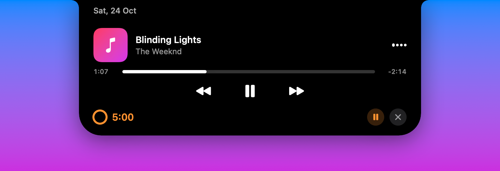
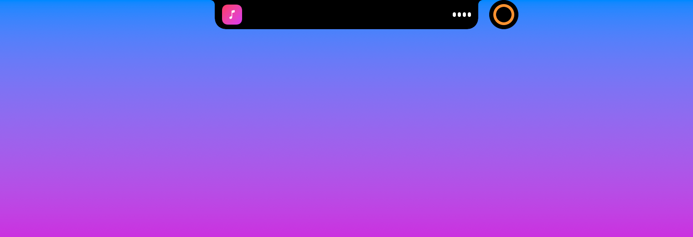
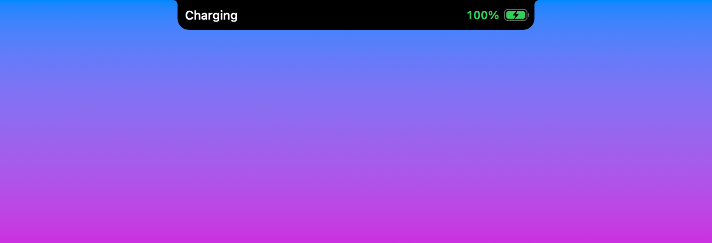
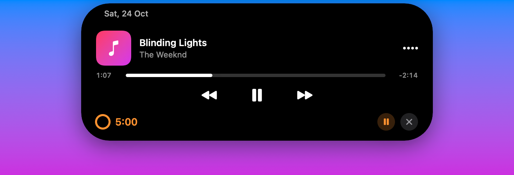

<div align="center">

# NotchIsland

**An iPhone-style Dynamic Island for your Mac's notch.**

Live activities for music, timers, charging, AirPods and volume — rendered natively with SwiftUI,
tucked into the notch when idle and springing open when something happens.

[](https://github.com/aayushsolanki40/NotchIsland/actions/workflows/build.yml)
[](https://github.com/aayushsolanki40/homebrew-tap)
[](https://github.com/aayushsolanki40/NotchIsland/releases/latest)


[](LICENSE)



</div>

## Features

| | |
|---|---|
| **Now Playing** | Album art, a waveform tinted with the artwork's colour, a draggable progress bar and previous / play-pause / next controls for **Music** and **Spotify**. |
| **Timer** | 1 / 5 / 10 / 25-minute presets, pause and cancel, a countdown in the compact island and a chime when it's done. |
| **Split island** | With music and a timer running together, the timer pops out into its own bubble — just like iPhone. |
| **Charging** | "Charging" + battery level slides out when you plug in. |
| **Low battery** | Red alert when the battery drops below 20 % and again at 10 %. |
| **AirPods & Bluetooth** | Device icon and a green battery ring when AirPods, Beats, keyboards or mice connect. |
| **Volume** | Speaker icon and level bar when the system volume or mute changes. |
| **Swipe to hide** | Two-finger swipe (or click-drag) sideways to tuck an activity away; it returns on its next update. |
| **Two styles** | *Notch* — attached to the notch with concave top corners. *iPhone Pill* — a floating capsule, ideal for Macs without a notch. |

<p align="center">
  <br>
  <br>
  <br>
  
</p>

## Requirements

- macOS 14 Sonoma or later
- Apple Silicon or Intel (universal binary)
- Works best on a MacBook with a notch; other displays get a virtual notch or the floating pill

## Installation

### Homebrew (recommended)

```bash
brew install --cask aayushsolanki40/tap/notchisland
```

That's it — the cask also clears the macOS quarantine flag, so the app opens without a
Gatekeeper warning. Update with `brew upgrade --cask notchisland` and remove with
`brew uninstall --cask notchisland` (add `--zap` to delete its preferences too).

### Download

1. Grab `NotchIsland.zip` from the [latest release](https://github.com/aayushsolanki40/NotchIsland/releases/latest).
2. Unzip and move **NotchIsland.app** to `/Applications`.
3. Release builds are ad-hoc signed, not notarized, so macOS will block the first launch. Clear the quarantine flag once:

   ```bash
   xattr -dr com.apple.quarantine /Applications/NotchIsland.app
   ```

   …or right-click the app → **Open** → **Open**.

### Build from source

Requires Xcode 15 or later (for the Swift toolchain and macOS SDK).

```bash
git clone https://github.com/aayushsolanki40/NotchIsland.git
cd NotchIsland
./build.sh && open build/NotchIsland.app
```

`./build.sh 1.2.0` stamps a version number into the app.

## Usage

NotchIsland lives in the menu bar (capsule icon) and has no Dock icon.

- **Hover** the notch to expand the island; move away to collapse it. **Click** works too.
- **Drag** along the progress bar to seek; click the album art to open the player app.
- **Swipe** sideways with two fingers to hide the current activity.

The menu bar icon offers:

| Menu item | What it does |
|---|---|
| Style | Switch between *Notch (attached)* and *iPhone Pill (floating)* |
| Expand on Hover | Turn hover-to-expand on or off (click always works) |
| Launch at Login | Start NotchIsland when you log in |
| Preview Charging / Low Battery / AirPods | Show that pop-up without the real event |
| Start 10s Timer | Quick way to see the timer activity |

### Permissions

macOS asks for these the first time each feature is used:

| Permission | Why |
|---|---|
| **Automation → Music / Spotify** | Read the current track and send playback commands |
| **Bluetooth** | Detect AirPods and other devices connecting |

If a feature stops working, check **System Settings → Privacy & Security** (Automation, Bluetooth).
Because local builds are ad-hoc signed, macOS may ask again after you rebuild.

## How it works

```
Sources/
├── main.swift / AppDelegate.swift   App entry, menu bar item, single-instance guard
├── IslandWindow.swift               Borderless non-activating panel above the menu bar;
│                                    passes clicks through except over the island; swipe detection
├── IslandModel.swift                Which activity shows, expansion state, sizes for every state
├── IslandView.swift                 All SwiftUI views (compact, expanded, music player, timer…)
├── IslandShape.swift                Animatable notch / pill shape and blur transition
├── NowPlayingService.swift          Music & Spotify via AppleScript
├── BatteryService.swift             IOKit power-source notifications
├── BluetoothService.swift           IOBluetooth connect notifications (+ battery via system_profiler)
├── VolumeService.swift              CoreAudio volume / mute listeners
└── TimerService.swift               Countdown timer
```

The island is a single SwiftUI view whose size and corner radii are derived from the current
state, so every transition is one spring animation. A transparent panel spans the top of the
screen; a 30 Hz mouse check makes it click-through everywhere except over the island itself.

## Limitations

- **Now Playing** only supports Music and Spotify. Since macOS 15.4 Apple restricts the
  system-wide Now Playing API (MediaRemote) to its own apps, so browsers and other players can't be read.
- **AirPods battery** comes from `system_profiler`, which may take a few seconds after connecting.
- **Volume** — the system volume HUD still appears alongside the island.
- **Live Activities from iPhone apps** (Uber, sports scores…), calls and Face ID are iOS-only and
  can't be shown.
- Not on the Mac App Store: the sandbox would block Spotify control and AirPods battery.

## Contributing

Bug reports, ideas and pull requests are welcome — see [CONTRIBUTING.md](CONTRIBUTING.md).
Please follow the [Code of Conduct](CODE_OF_CONDUCT.md), and report security issues privately as
described in [SECURITY.md](SECURITY.md).

## License

[MIT](LICENSE) © 2026 Aayush Solanki

---

<sub>NotchIsland is an independent project and is not affiliated with or endorsed by Apple Inc.
iPhone, Mac, AirPods and Dynamic Island are trademarks of Apple Inc.</sub>
